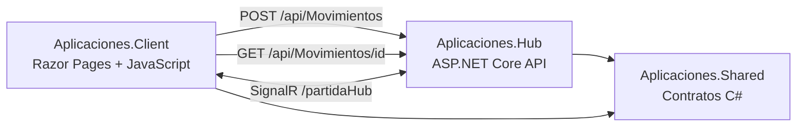

# TicTacToe multijugador con SignalR y .NET 10

Proyecto basado en la arquitectura del taller **Aplicaciones en tiempo real con SignalR y .NET 10**. La solucion tiene tres proyectos: servidor, cliente y biblioteca de contratos compartidos.

## Arquitectura



- **Aplicaciones.Hub** (proyecto `Aplicaciones.csproj` en la raiz): aloja la API REST, valida movimientos y publica el Hub.
- **Aplicaciones.Client**: interfaz Razor Pages, cliente JavaScript, tablero e historial.
- **Aplicaciones.Shared**: contratos C# que se comparten entre servidor y cliente .NET. El navegador recibe los objetos serializados como JSON; no importa clases C#.

## Requisitos y compilacion

Necesitas el SDK de .NET 10 y Library Manager para descargar la biblioteca de SignalR del navegador.

```powershell
dotnet tool install -g Microsoft.Web.LibraryManager.Cli
cd Aplicaciones.Client
libman restore
cd ..
dotnet restore Aplicaciones.sln
dotnet build Aplicaciones.sln
```

Si Library Manager ya esta instalado, no repitas la instalacion.

## Ejecutar

Terminal 1, servidor API + Hub:

```powershell
dotnet run --project Aplicaciones.csproj --urls http://0.0.0.0:5001
```

Terminal 2, cliente web:

```powershell
dotnet run --project Aplicaciones.Client --urls http://0.0.0.0:5002
```

Abre `http://localhost:5002`. Para jugar desde dos computadoras, ambas deben abrir `http://IP-DEL-SERVIDOR:5002`. Permite los puertos TCP 5001 y 5002 en el firewall del equipo que ejecuta el servidor. El cliente obtiene el host desde la URL del navegador y usa el puerto 5001 para API y SignalR.

La politica CORS del servidor permite origenes en los puertos 5002 y 7002 para esta practica. En produccion, limita CORS a origenes concretos y usa HTTPS.

## API solicitada

### POST `/api/Movimientos`

Ejemplo de cuerpo JSON:

```json
{
  "partidaId": "partida-1",
  "fila": 0,
  "columna": 1,
  "jugador": "X"
}
```

Registra un movimiento y devuelve el estado actualizado. Devuelve 400 si los datos son invalidos y 409 si no corresponde el turno, la casilla esta ocupada o la partida termino.

### GET `/api/Movimientos/{partidaId}`

Devuelve el tablero, el turno actual, el ganador/empate y el historial. Devuelve 404 si todavia no existe una partida con ese identificador.

## SignalR

- Hub: `/partidaHub`
- Metodo invocado por el cliente: `UnirsePartida(partidaId)`
- Evento del servidor: `MovimientoActualizado`
- Grupo: cada partida tiene su propio grupo. Las jugadas de una partida no se envian a otra.
- Reconexion: el cliente usa `withAutomaticReconnect()` y vuelve a unirse al grupo despues de reconectar.

## Validaciones

- Identificador requerido y maximo de 50 caracteres.
- El jugador solo puede ser X u O.
- Fila y columna entre 0 y 2.
- El servidor valida el turno, las casillas ocupadas y el fin de la partida.
- Los errores se muestran en la interfaz y tambien se devuelven desde la API.
- El historial se representa con `textContent` para tratar los datos como texto, no como HTML.

## Pruebas manuales recomendadas

1. Ejecuta `dotnet restore` y `dotnet build` desde la raiz.
2. Abre dos navegadores con el mismo identificador; selecciona X en uno y O en el otro.
3. Haz una jugada con X y confirma que aparece en ambos tableros sin recargar.
4. Intenta jugar fuera de turno y ocupar una casilla ya usada; el servidor debe rechazarlo.
5. Comprueba una victoria y un empate.
6. Usa otro identificador en una tercera pestaña y confirma que no recibe eventos de la primera partida.
7. Deten y reinicia el servidor para comprobar que las partidas en memoria no son persistentes.

## Como se integran REST y SignalR

La API REST recibe y valida cada movimiento. Solo despues de aceptarlo, el servidor emite el estado actualizado por SignalR al grupo de esa partida. REST procesa la operacion; SignalR notifica el cambio en tiempo real sin recargar la pagina.

## Seguridad y limitaciones

El nombre X/O no es una identidad autenticada. Para produccion, agrega autenticacion y autorizacion para unirse a una partida, persistencia de datos y una politica CORS con origenes exactos. El estado actual vive en memoria y se pierde al reiniciar el servidor.

La captura de pantalla y la demostracion funcional deben realizarse ejecutando el proyecto. No se afirma que las pruebas manuales hayan sido ejecutadas en este entorno.
